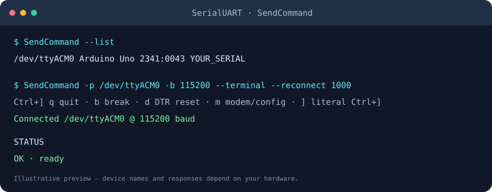

# SerialUART

[](https://github.com/DRSDavidSoft/SerialUART/actions/workflows/build.yml)
[](https://github.com/DRSDavidSoft/SerialUART/releases)


**One small C library. Real serial ports. Your terminal, scripts, and applications.**

SerialUART configures and exchanges arbitrary bytes with serial devices on Windows,
Linux, Raspberry Pi OS, and macOS. Use the C ABI from C++, a language binding, or
the included `SendCommand` executable. The library and CLI use the C runtime and
native OS APIs; they require no third-party serial, USB, networking, or JSON libraries.



## Start here

```sh
SendCommand --list
SendCommand --port COM12 --baud 115200 --send STATUS
SendCommand --port /dev/ttyACM0 --baud 115200 --terminal
```

| Need | Use |
|---|---|
| A library for an application or binding | [C API and C++ usage](docs/API.md) |
| Build, install, or cross-compile | [Build guide](docs/BUILDING.md) |
| A serial terminal or binary pipeline | [CLI guide](docs/USAGE.md) |
| Arduino reset control | [DTR and Arduino](docs/USAGE.md#arduino-and-dtr) |
| TCP, WebSocket, or Socket.IO bridge | [Host adapters](docs/NETWORK.md) |
| Build packages and draft releases | [CI/CD and validation](docs/BUILDING.md#cicd) |

## Capabilities

- C99 API, C++ linkage, static libraries and shared libraries for bindings.
- Windows `CreateFile`/DCB and POSIX `termios`, with baud, data bits, parity,
  stop bits, DTR, RTS, RTS/CTS, timeouts, partial I/O and break control.
- Friendly names and USB VID/PID/serial discovery through SetupAPI on Windows,
  sysfs on Linux, and IOKit on macOS. Enumeration never opens a port.
- Selection by exact path, exact name, VID/PID, serial number, or combined filters.
  Ambiguous matches are rejected rather than choosing a device arbitrarily.
- Automatic serial reconnect with fresh discovery and explicit DTR policy.
- Raw terminal with prefix shortcuts; binary-safe stdin/stdout pipelines;
  one-shot text and hex commands with configurable reply timeout.
- Optional one-peer TCP, WebSocket and Socket.IO bridge examples, built into
  the CLI. Network code is separate from the serial library.

## Build in three steps

Install a C/C++ compiler and CMake 3.16 or newer, then:

```sh
cmake -S . -B build -DCMAKE_BUILD_TYPE=Release
cmake --build build --config Release
ctest --test-dir build -C Release --output-on-failure
```

The program is `build/SendCommand` on Unix and usually
`build/Release/SendCommand.exe` with Visual Studio. With MinGW/Ninja it is
`build/SendCommand.exe`. See the [build guide](docs/BUILDING.md) for installation,
shared libraries, direct compiler commands, and Raspberry Pi cross compilation.
Python 3 is used only for optional integration tests and release tooling.

## Platform evidence

| Platform | Automated coverage | Native dependencies |
|---|---|---|
| Windows x64 | MSVC static/shared; TCP/WS/Socket.IO; local MinGW build | SetupAPI, Advapi32, Winsock |
| Linux x64 | GCC and Clang static/shared; pseudo-terminal serial tests | libc / POSIX |
| Linux ARM64 / 64-bit Pi OS | Native GCC static/shared and pseudo-terminal tests | libc / POSIX |
| Linux ARMv7 / 32-bit Pi OS | GCC cross build, tests under QEMU | libc / POSIX |
| macOS ARM64 | Apple Clang static/shared, IOKit build and pseudo-terminal tests | IOKit, CoreFoundation |

CI validates source, protocol exchanges, virtual serial I/O, installation and
packages. It does **not** prove physical USB device metadata, DTR/reset timing,
real Windows serial I/O, or operation on a physical Raspberry Pi. Use the
[hardware checklist](docs/VALIDATION.md) for those checks. Older Pi ARMv6 boards,
Windows ARM64/x86, BSD, Android and iOS are not current CI targets.

## Project history

Version 2 replaces the incomplete v1.3 Windows prototype with a callable library
and portable CLI. `SendCommand` retains its original send-and-receive purpose.
The old `.c` inclusion and global variables have been removed; see
[migration notes](docs/USAGE.md#migrating-from-v13).

Created by **David Refoua**. Historical acknowledgements are preserved in
[CONTRIBUTORS.md](CONTRIBUTORS.md). The historical repository did not specify a
project-wide license; this update does not silently assign new licensing terms.
