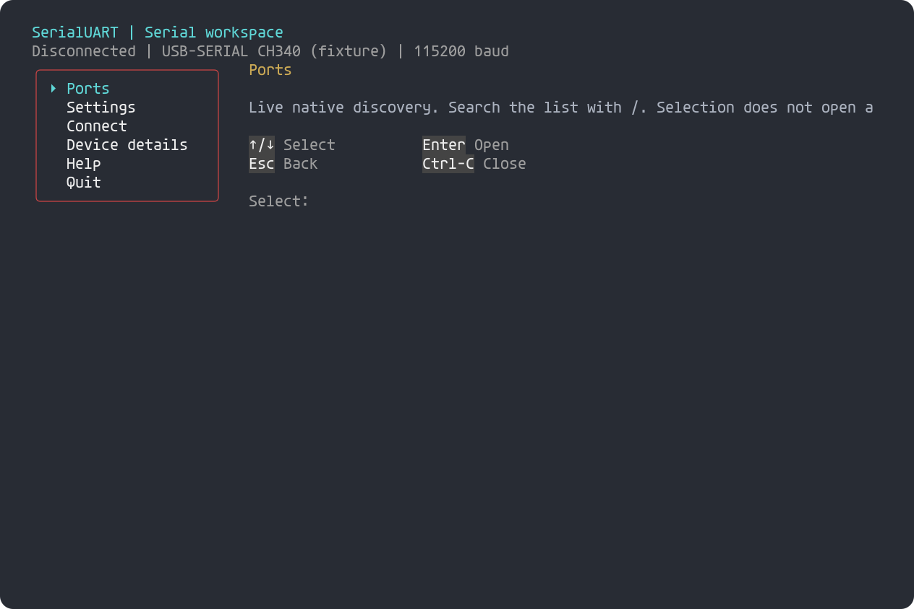
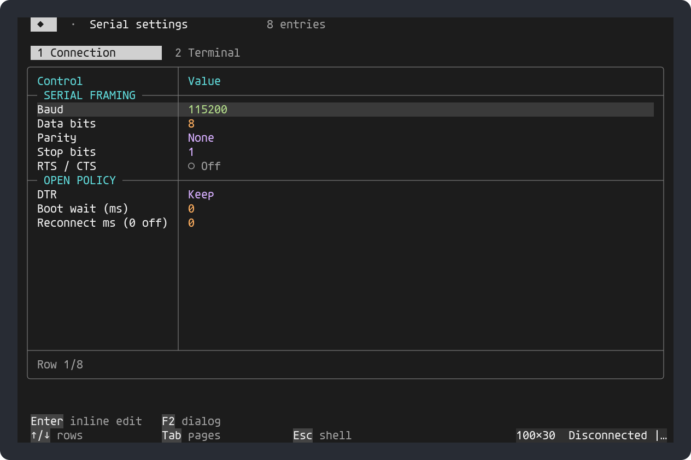

# Interactive serial workspace

```sh
SerialUART
SerialUART --port /dev/ttyACM0 --baud 115200 --log capture.bin
SerialUART --match CH340 --reconnect 1000
```

Choose **Ports**, filter the list with `/`, then select a device. Selection does
not open the port. **Settings** edits baud, framing, flow control, DTR policy and
reconnect interval in their cells. Choose **Connect** when ready; it becomes
**Disconnect**, which closes the port and cancels automatic reconnect.
Settings that affect opening/framing are locked while connected or reconnecting.
The console starts disconnected even when a selector is supplied.



The embedded PortableShell C99 framework provides responsive menus, searchable
lists, editable tabbed tables, forms, read-only scrolling reports, semantic
colors, command history/completion and terminal resize handling. Its application
registry contains SerialUART commands only; it never executes an OS shell.
Both stdin and stdout must be terminals. `SerialUART` opens this workspace by
default; `--interactive` explicitly selects it in a profile. Use `--pipe` for a
full-application binary pipeline, or `SendCommand` for the small pipeline tool.
`--terminal` selects the direct terminal without menus. Redirected input/output
in default interactive mode is rejected; menus never enter a binary pipe.



## Keys and navigation

| Context | Keys |
|---|---|
| Menu/list | ↑/↓, Enter, Esc; `/` filters a port list |
| Settings | Enter edits a cell; Ctrl+U clears it; Esc cancels; Tab changes page |
| Command prompt | `menu`, `ports`, `settings`, `connect [PATH]`, `disconnect` |
| Terminal | Ctrl+] then `m` returns to the menu; `q` quits; `]` sends literal Ctrl+] |
| Read-only reports | Scroll with navigation keys; Esc returns to the prompt |

Use **Terminal** after connecting. Ctrl+C and Ctrl+D are delivered to the board.
Local echo, line editing, display format and custom Enter bytes are editable in
the Terminal settings page. Returning to the menu discards an unsubmitted line.
Type `help` at the command prompt for the console guide.

## Inspect, capture and transmit

- **Device details** shows native metadata, model catalog, session byte counts
  and current driver configuration. Catalog recognition does not identify firmware.
- **Modem signals** distinguishes On, Off and Unknown. Windows does not supply
  output-line readback through the serial API; those outputs remain Unknown.
- Explicit DTR/RTS and break actions are available only while connected.
- **Send hex bytes** validates a draft before sending; the command equivalent is
  `sendhex 00 FF 0D`. The form holds 127 characters (up to 63 compact hex
  bytes); the command accepts up to 256 bytes. Data is sent once, with the
  configured write deadline.
- **Receive history** keeps the latest 8192 bytes while menus are open. The text
  view escapes control/high bytes, and **Hex history** shows the latest 1024
  bytes. Views are snapshots; reopen to refresh. Oldest bytes are replaced.
- `--log capture.bin` writes the complete received byte stream, including data
  received while viewing menus. Existing display-log and timestamp options work.
  Menu output is never included in serial capture logs.

Reconnect follows the selected serial number, otherwise the native instance,
otherwise the exact path plus known USB IDs. It never silently changes to an
unrelated same-model device. A manual disconnect cancels the retry intent.
Write failures close the connection and report uncertain delivery; no bytes are
replayed. Opening can have driver-specific DTR effects: see the Arduino guide.

Set `NO_COLOR=1` for no color, or `SUART_ASCII=1` for ASCII UI glyphs.
This release does not add X/Y/ZMODEM, modem dialing scripts or a claim of complete
minicom feature parity. Its focus is device identity, interactive configuration,
scriptable byte I/O and a richer native console.

## Native discovery and bindings

```sh
SendCommand --list-devices
SendCommand --list-devices --output-format json
SendCommand --list-devices --output-format json --match QinHeng
SendCommand --instance 'USB\VID_1A86&PID_7523\DEVICE' --baud 115200 --terminal
```

`--match` performs ASCII case-insensitive substring matching across port,
friendly name, manufacturer, product, serial and instance. Existing `--name`
remains exact. All selectors combine with AND and ambiguous selection fails.
Extended selectors also obey include/exclude/block rules. Listing and browsing
never open ports or pulse DTR. JSON uses numeric VID/PID and null for unknown
problem status; an empty metadata string means unavailable.

The additive `suart_enumerate_ex`, `suart_resolve_ex`, `suart_device_matches` and
`suart_discovery_source` APIs expose the same metadata to bindings while retaining
old `suart_device` and `suart_selector` layouts. Windows enumerates present
SetupAPI Ports devnodes and walks live Configuration Manager parents for USB
identity. Linux inspects sysfs device/USB ancestors, including uncommon tty names.
macOS uses IOKit callout devices and USB ancestors. Instance IDs are OS topology
identifiers; moving USB ports may change them. Serial numbers are preferred.
Windows problem codes describe present port devnodes, not a complete scan of
unbound USB devices or a diagnosis of every missing-driver/descriptor failure.

## Source integration

The PortableShell framework is pinned at
[`76685c2`](https://github.com/atomicdeploy/portable-shell/tree/76685c29dc56842ea86e0a0e8dbf2cdb71b50c88).
Its unmodified C sources and MIT notice are included; no installed runtime
library or dependency fetch is required. The UI is confined to the CLI adapter.

Discovery and selection were compared with PCController's
[`internal/ports`](https://github.com/atomicdeploy/PCController/tree/e5084a7343a6eb8a222938b3047e2c9431379093/Tools/Controller/internal/ports)
and interactive selector. Native C implementations retain its useful principles:
OS-present device authority, stable identity before remembered port names,
manufacturer/product fallback, explicit ambiguity and unknown-state reporting.
The Go runtime, controller protocol/firmware and third-party Go dependencies are
not imported into SerialUART.

## Preview provenance

The previews use actual PortableShell output from `console_test --preview FILE`
and `console_test --preview-settings FILE` at 100×30 cells. Fixture metadata is
clearly marked; no physical board is connected. The upstream
`tools/terminal_animation.c` renders a PSREPLAY recording of those bytes, then
usvg/resvg 0.45.1 outline/rasterize Agave text. The Agave license is included.
